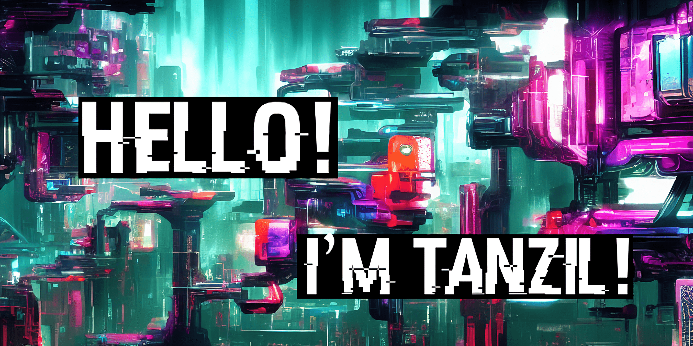

    <a target="_blank" href="https://www.linkedin.com/in/tanzilzubair"></img></a>
    <a target="_blank" href="https://tanzilzubair.tech/projects/"></img></a>
    <!-- <a target="_blank" href="https://tanzilzubair.tech/blog/"></img></a> -->

## Hey, I'm Tanzil 👋

I'm a senior at Michigan State University graduating May 2027 with a BS in Computer Science, a BA in Economics, and a minor in Computational Mathematics. I build full-stack applications, ship mobile apps to production, and publish open-source libraries. 

Currently exploring the intersection of software engineering and finance, and looking for full-time SWE and fintech roles starting summer 2027.

---

## 🛠️ Tech Stack

**Languages**

**Frameworks & Libraries**

**Data & Infrastructure**

---

## 📩 Contact

Reach me at [zamantan@msu.edu](mailto:zamantan@msu.edu) or connect on [LinkedIn](https://www.linkedin.com/in/tanzilzubair/).
